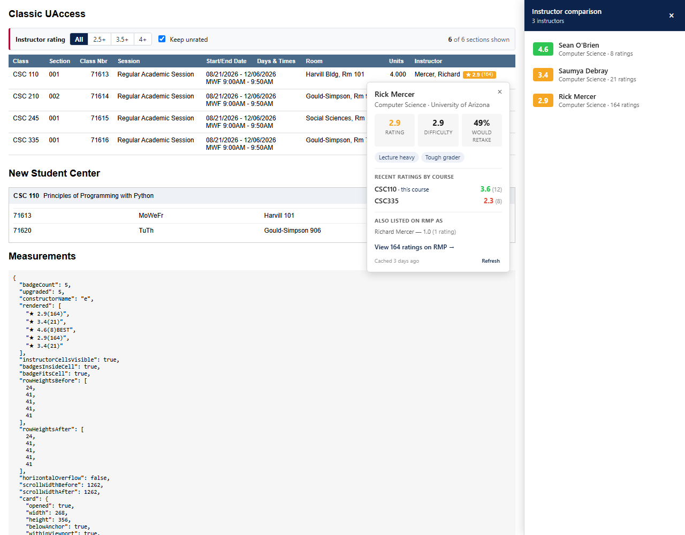
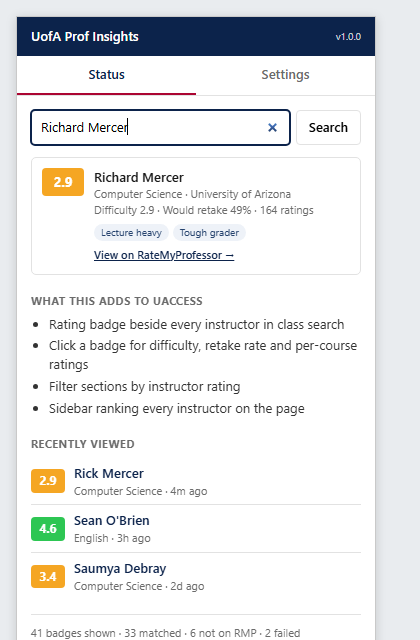
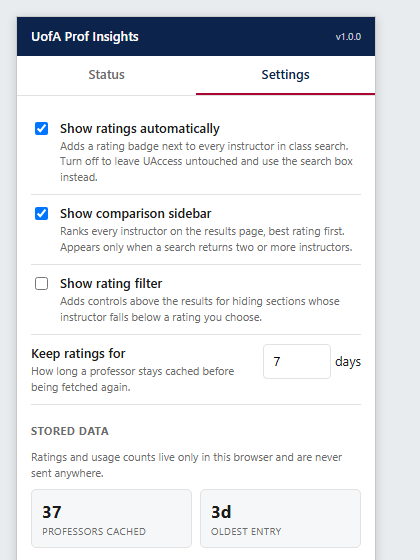

# UofA Prof Insights

**RateMyProfessor ratings inline in UAccess, so you can pick a section without
leaving registration.**

A Chrome extension (Manifest V3) for University of Arizona students. It reads
instructor names off the class search page, resolves them to the right
RateMyProfessors profile, and renders ratings next to each section — plus the
things a browser tab open on RateMyProfessors structurally cannot do: rank every
instructor on the page against each other, break a rating down by course, and
hide sections below a threshold.

[Install](INSTALL.md) · [Privacy](PRIVACY.md) · 474 tests · verified as a side-loaded extension

> **Distributed by zip, not through the Chrome Web Store.** The extension reads
> RateMyProfessors through a private API and carries the university's name, so a
> public listing under an individual's name is not a trade worth making for an
> audience of classmates. [STORE.md](STORE.md) keeps the prepared listing and the
> reasoning.



_Badges sit inside the Instructor column; the card breaks the rating down by
course and discloses duplicate profiles; the sidebar ranks the page._

<table>
<tr>
<td width="50%"></td>
<td width="50%"></td>
</tr>
</table>

## Why not just Google the professor?

For one professor, this saves about fifteen seconds. That is not the argument.

**Googling is often wrong, invisibly.** UAccess lists an instructor as
"Mercer, Richard". The top RateMyProfessors result for that name is a
**Richard Mercer at Wright State University in Ohio, with 63 ratings** — nothing
on the page tells a student they are reading about the wrong person. Meanwhile
UofA's Computer Science department has three Mercers, and the profile carrying
this professor's 164 ratings is filed under "**Rick**".

Beyond correctness, three things only work from inside the results page:

- **A class search returns 8–20 instructors.** Checking each by hand means
  losing your place in the results, twenty times, during a registration window
  where seats disappear in minutes.
- **The question is comparative** — "which of these eight", not "is this one
  good". Nobody holds eight ratings in their head.
- **Course-specific ratings.** A professor can be strong in a survey course and
  punishing in a seminar. Getting that from the website means reading 164
  reviews by hand.

## Status

**Feature complete, verified in Chrome, and packaged.** 371 tests pass, the
built bundle is exercised in real headless Chrome (see
[Browser verification](#browser-verification)), and `npm run package` produces a
Chrome Web Store-ready zip. The remaining unknown is live UAccess markup, which
needs a NetID login.

## How it works

```
detector-classic.ts ─┐
                     ├─> detector.ts ──> injector.ts ──> Badge  <upi-badge>
detector-new.ts    ──┘   (MutationObserver,  (dedupes,       │  click
                          250ms debounce)     prunes stale)  └─> Card <upi-card>
                                     │
                                     └─> sidebar-controller ──> <upi-sidebar>
                                                                (2+ instructors)
       index.ts ──chrome.runtime.sendMessage──> service-worker ──> cache ──> rmp-api
       popup/  ──────────────────────────────────────┘
```

Both detectors run on every pass; each is a scoped `querySelectorAll` that
returns nothing on the other layout, so no page sniffing is needed and a hybrid
page is still covered.

## Features

- **Inline badges** next to every instructor, colored by rating.
- **Detail card** on badge click: rating, difficulty, would-retake, top tags,
  and a link to the RMP page. One card at a time; closes on Escape, outside
  click, or a second click on the same badge.
- **Comparison sidebar** ranking every instructor on the results page,
  best-first. Only appears with two or more instructors, since one has nothing
  to compare against. Clicking a row scrolls to that badge.
- **Rating filter** above the results: hide sections whose instructor falls below
  a threshold, with a live count. Co-taught sections survive if any instructor
  passes; "Staff" rows count as unrated.
- **Per-course ratings** on the card, with the course being browsed pinned first
  — derived from review data the tags query already downloaded.
- **Duplicate-profile disclosure.** Where two RMP profiles look like the same
  person, the better-evidenced one is shown and the others are listed.
- **Page ranking.** Each badge knows its standing among the rated instructors on
  the page; the top pick gets a BEST pill.
- **Popup** with a manual professor search, recently viewed professors, a
  local-only usage tally, and settings.
- **Retry and refresh.** An errored badge refetches when clicked, and the card's
  Refresh button re-pulls a stale record. Both bypass the cache via
  `REFRESH_PROFESSOR`, since a failed lookup is deliberately never cached and a
  plain lookup would just replay the failure.
- **Idempotent injection.** A second content-script injection into the same page
  tears down the first, so re-injection cannot double-register listeners or
  observers.

All in-page UI is shadow-DOM encapsulated, so PeopleSoft's stylesheets cannot
reach in and our styles cannot leak out.

## Engineering problems worth writing down

Five findings that changed the design, each verified against the live API rather
than assumed.

### 1. The school ID everyone cites is UCLA

`U2Nob29sLTEwNzU=` (base64 `School-1075`) is widely quoted as University of
Arizona. It is **UCLA**. It fails silently: a search for "Rick Mercer" returns
"Rick Miller, Geography, UCLA" — plausible-looking data from the wrong
university. UofA is `School-1402`.

### 2. Searching a full name buries the person you want

RMP ranks results by _given_ name. Querying `"Richard Mercer"` returns ten
unrelated Richards from across campus and **omits every Mercer**. Querying
`"Mercer"` returns exactly the three. Lookups therefore search by surname and
match locally, falling back to the full name only when a surname page comes back
empty or truncated.

### 3. A given name maps to a set, not a canonical form

The first version of the nickname table kept one binding per short form, which
mapped "Rick" to Frederick purely because it sorted earlier — so Rick never
matched Richard, the exact case the table existed for. Pat/Patrick and
Steve/Stephen broke the same way. Names now resolve to the _set_ of formal names
they could stand for, and two names match when those sets intersect. The
relation is deliberately not transitive: Pat matches both Patrick and Patricia,
which never match each other.

### 4. Rating fields use sentinels, and the tags field is a lie

`avgRating` is `0` for unrated professors and `wouldTakeAgainPercent` is `-1`
for "no data" — both mapped to `null`, while a genuine `0%` is preserved.
`Teacher.teacherRatingTags` returns an empty array even on a direct node lookup;
tags have to be tallied client-side from a `--`-delimited string on individual
ratings. That same query already carried each review's course and scores, which
is where the per-course breakdown comes from at no extra cost.

### 5. A colspan in the results grid shifts the instructor column

UAccess merges "Start/End Date" and "Days & Times" into one `colspan="2"` cell,
so the instructor `<td>` sits one index left of its `<th>`. Walking raw child
indexes lands on Units and badges every row with "4.000". Column resolution
accounts for colspan and accepts only `<td>`.

A sixth was caught only by looking at a screenshot: the `position: fixed`
comparison sidebar **covered the Instructor column** — the column the badges
attach to — while every overflow assertion passed, because a fixed element
overlays content instead of extending the page. The sidebar now reserves its
width by padding the body.

## Commands

```bash
npm run dev         # Vite + CRXJS dev server with HMR
npm run build       # production build into dist/
npm run package     # build, then zip to release/ for the Web Store
npm run icons       # regenerate src/assets/icon-*.png from source
npm test            # unit tests (offline, deterministic)
npm run test:live   # hits the real RMP API — run after any RMP schema change
npm run verify:browser  # drives the built bundle in real headless Chrome
npm run typecheck   # tsc --noEmit, strict
npm run check       # typecheck + lint + format:check + test
```

Load the unpacked extension from `dist/` via `chrome://extensions` →
"Load unpacked".

### Releasing

1. Bump `version` in **both** `manifest.json` and `package.json` — `npm run
package` refuses to build if they disagree, since the store rejects a
   mismatch.
2. `npm run check` to gate.
3. `npm run package` → `release/uofa-prof-insights-<version>.zip`.
4. Upload that zip to the Chrome Web Store, or share it with
   [INSTALL.md](INSTALL.md) for unpacked install.

The icons are generated from [scripts/generate-icons.mjs](scripts/generate-icons.mjs)
— a rounded cardinal tile with a white star, rasterized by hand so no image
library is needed. The packaging script writes the zip by hand for the same
reason.

## Phase 0 findings

These were all verified against the live API, and each one is load-bearing.

### The UofA school ID is `School-1402`, not `School-1075`

`U2Nob29sLTEwNzU=` (base64 `School-1075`) is **UCLA**. Querying it returns
plausible-looking results from the wrong university — a search for "Rick Mercer"
returns "Rick Miller, Geography, UCLA". The correct value is
`U2Nob29sLTE0MDI=` (`School-1402`, Tucson, ~848 ratings).

### UAccess is not served from `uaccess.arizona.edu`

That host is only the portal landing page. Class search and registration live on
subdomains, which Chrome match patterns do **not** cover implicitly:

- `student.uaccess.arizona.edu`
- `student851.uaccess.arizona.edu`
- `studentcenter.arizona.edu`

All four hosts are in the manifest, and the content script runs with
`all_frames: true` because PeopleSoft renders into an iframe.

### The teacher search is fuzzy

A school-scoped search for "Rick Mercer" returns 10 hits, including "Dave Rick"
and "Rick Yngve". `selectExactMatch()` therefore accepts only exact first+last
matches. A looser rule (surname + first initial) would conflate the real,
distinct UofA professors "Rick Mercer" and "Richard Mercer" — showing the wrong
person's rating is worse than showing none. Ties break toward the profile with
the most ratings, which handles RMP's duplicate and typo'd profiles.

### Rating fields use sentinel values

- `avgRating` / `avgDifficulty` are `0` for unrated professors — mapped to `null`
- `wouldTakeAgainPercent` is `-1` for "no data" — mapped to `null`, while a
  genuine `0` is preserved

### `teacherRatingTags` is always empty

Even on a direct `node(id:)` lookup. Top tags have to be tallied client-side
from the `--`-delimited `ratingTags` string on individual ratings, via a second
query. `fetchTopTags()` does this and degrades to `[]` rather than failing the
whole lookup.

## Browser verification

jsdom has no layout engine, so the unit suites cannot answer the questions that
matter most for an in-page extension. `npm run verify:browser` runs the **real
built bundle** in **real headless Chrome** against mock UAccess markup, takes
measurements from the live page, and writes a screenshot to
`release/verify/uaccess-mock.png`.

24 checks across three surfaces — the injected UAccess page, the popup's Status
tab, and its Settings tab. It asserts, among other things, that custom elements
upgrade, that badges stay inside their table cell, that row heights are
identical before and after injection, that nothing overflows horizontally, that
neither the card nor the sidebar covers the instructor column, and that the
popup renders its stored settings.

Two real bugs came out of looking at that screenshot, both invisible to the
numeric checks:

- The `position: fixed` sidebar **covered the Instructor column** — the very
  column the badges attach to. `horizontalOverflow` was false the whole time,
  because a fixed element overlays content instead of extending the page. The
  sidebar now pads the body by its measured width, and a check pins it.
- The sidebar's name and subtitle **ran together on one line**, because the
  wrapper was an inline `<span>`. Now a flex column.

### Still needs a human

- **Real UAccess ids.** Selectors come from the two supplied snippets; live
  PeopleSoft may carry extra instance suffixes. This is the one thing the
  harness cannot stand in for, since it needs a NetID login.
- **Chrome's isolated world.** The harness loads the bundle as a plain module,
  which exercises the same custom-element upgrade path but not the extension
  isolated world specifically.
- Whether real UAccess CSS interacts with the shadow roots in ways the mock
  stylesheet doesn't reproduce.

## Privacy

Nothing about the user is collected or transmitted. The only outbound request is
a professor's name to RateMyProfessors; cache, recents and usage counters live in
`chrome.storage.local` and never leave the browser. Usage counters are
deliberately local rather than server-side — the privacy claim is worth more than
aggregate analytics. Full policy: [PRIVACY.md](PRIVACY.md).

## Known gaps

- **Multiple instructors per section** are supported (a `<br>`-separated cell
  gets one badge per name), but each badge is looked up independently — there is
  no "primary instructor" concept yet.
- **TypeScript files are not linted.** typescript-eslint refuses to load against
  TypeScript 7 (TS 6 only shipped as a beta, so downgrading isn't an option).
  `npm run typecheck` covers the ground in the meantime. See
  [eslint.config.js](eslint.config.js).
- **Sidebar dismissal is page-scoped**, not persisted. Closing it lasts until
  the next page load; the permanent switch is the `showComparison` setting.
- A deprecation warning from `@crxjs/vite-plugin` about `server.hmr.*` appears
  during builds. It originates inside the plugin, not this config.
